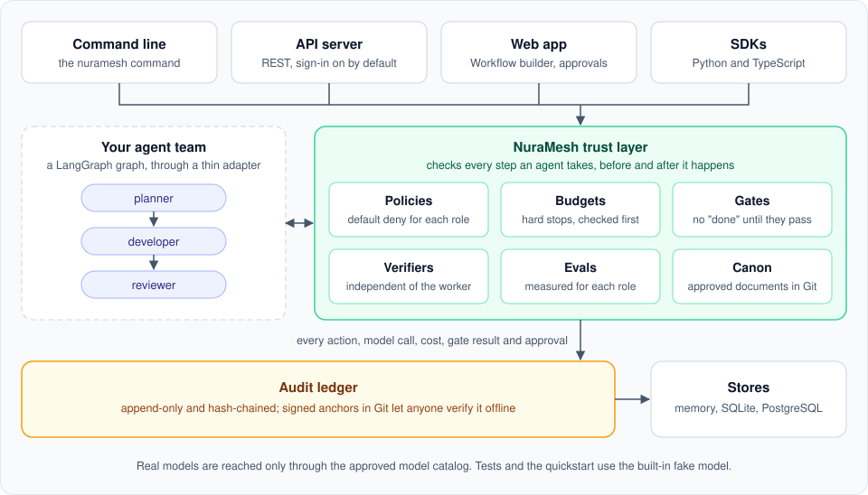
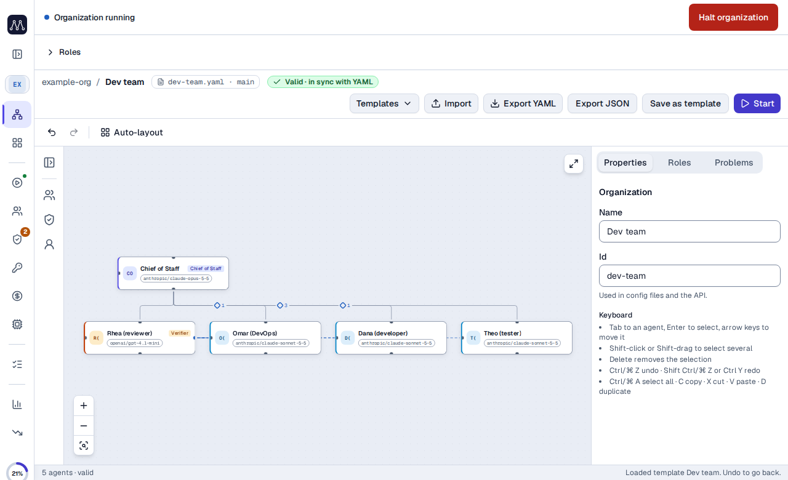

<p align="center">
  <picture>
    <source media="(prefers-color-scheme: dark)" srcset="docs/assets/logo-dark.svg">
    
  </picture>
</p>

<h3 align="center">The Control Plane for AI Agents.</h3>

<p align="center">
  <a href="https://github.com/nuramesh/nuramesh/releases"></a>
  <a href="LICENSE"></a>
  <a href="https://github.com/nuramesh/nuramesh/actions/workflows/ci.yml"></a>
  <a href="https://www.linkedin.com/company/nuramesh"></a>
  <a href="https://x.com/NuraMeshAI"></a>
</p>

<div align="center">

[Docs](https://docs.nuramesh.com) · [Quickstart](https://docs.nuramesh.com/get-started/quickstart/) · [Examples](examples/) · [Discussions](https://github.com/nuramesh/nuramesh/discussions) · [Security](SECURITY.md)

</div>

NuraMesh is an open-core platform for agent teams whose work is verified. You define an organization of
agents as a graph. NuraMesh adds verification gates, evals per role, budgets with hard stops, a shared
canon from Git, an append-only ledger of every action, and default-deny autonomy policies. It builds on
existing frameworks (LangGraph first) and does not replace them. Status: pre-1.0, interfaces may change.





*The web app's Workflow builder with the Dev team template loaded (a screenshot of the app on its
built-in sample data).*

## Why NuraMesh

Agent frameworks make it easy to get agents to act. They do not tell you whether the work is right, what
it cost, or who allowed it. NuraMesh is the trust layer around the framework you already use:

- **Verification gates:** a task counts as done only when its gates pass, checked by independent verifiers
  that never see the worker's reasoning.
- **Budgets with hard stops:** checked before every model call and recorded after it.
- **Default-deny autonomy policies:** an agent does only what its role allows; everything else asks a person.
- **Append-only ledger:** every action, model call, cost, gate result and approval, hash-chained and
  checkable offline.
- **Canon from Git:** each run records which version of your documents it used.
- **Evals per role:** measure each role, not only the final answer.

## Quickstart

You need Python 3.12 or newer. In a virtual environment and a throwaway folder:

```sh
pip install "nuramesh[local]"
nuramesh init my-team --template dev-team
nuramesh validate my-team/nuramesh.yaml
nuramesh try my-team --fake --approve-as human:you --allow-unsandboxed --run-id first-run
nuramesh ledger verify --team my-team
```

The run uses the built-in fake model: no keys, no cost. The [Quickstart](https://docs.nuramesh.com/get-started/quickstart/)
explains each step, including how to run the sample team's tests in a container. Other install options
(`server`, `postgres`, `langgraph`, `otel` and more): see [Install](https://docs.nuramesh.com/get-started/install/).

## Resources

- [Documentation](https://docs.nuramesh.com) and [Install options](https://docs.nuramesh.com/get-started/install/)
- [Templates](https://docs.nuramesh.com/get-started/templates/) and [examples](examples/)
- [Model governance](https://docs.nuramesh.com/concepts/model-governance/)
- [Command line](https://docs.nuramesh.com/reference/cli/) and [REST API](https://docs.nuramesh.com/reference/api/)
- [Environment variables](https://docs.nuramesh.com/reference/environment/) and [Telemetry](https://docs.nuramesh.com/guides/telemetry/)
- [Self-hosting preview](https://docs.nuramesh.com/guides/self-hosting/) (coming soon, not yet supported)
- [Contributing](CONTRIBUTING.md), [Code of conduct](CODE_OF_CONDUCT.md) and [Discussions](https://github.com/nuramesh/nuramesh/discussions)
- Security: report vulnerabilities to security@nuramesh.com as [SECURITY.md](SECURITY.md) describes, not in a public issue.

## Licence

Apache License 2.0: see `LICENSE` and `NOTICE`. The name and logo are covered by `TRADEMARKS.md`.
Enterprise features (single sign-on, SCIM, custom roles, streaming audit export) are a separate
commercial product and are not in this repository.
