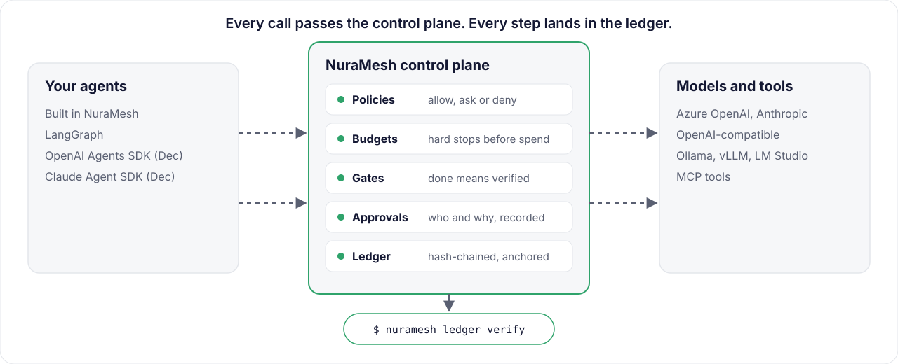
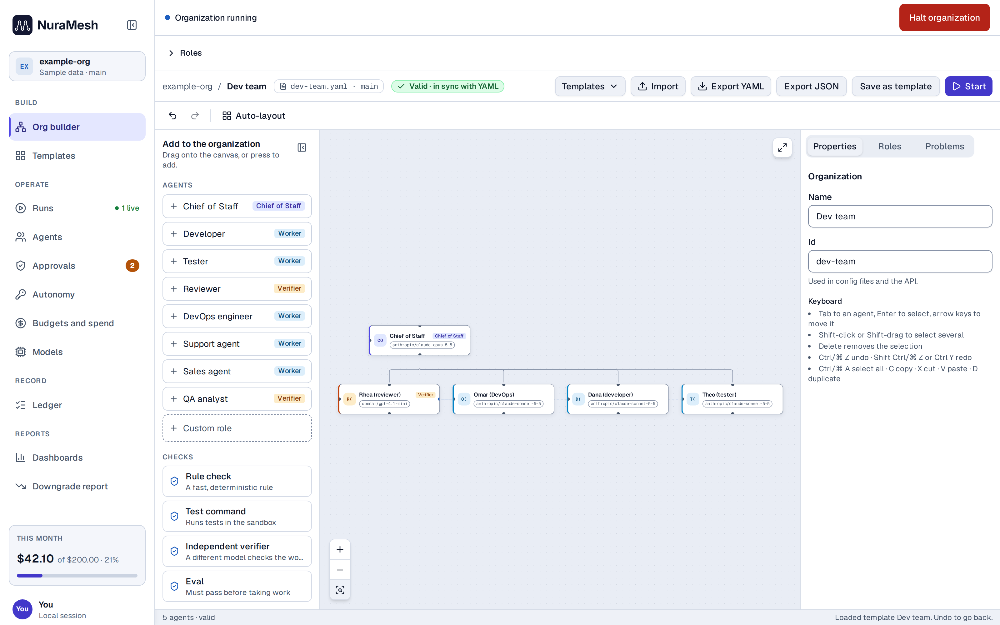

<p align="center">
  <picture>
    <source media="(prefers-color-scheme: dark)" srcset=".github/images/logo-dark.svg">
    
  </picture>
</p>

<h3 align="center">The AI control plane for agents you can trust.</h3>

<p align="center">Every action verified, approved where it matters, and always on the record.</p>

<p align="center">
  <a href="LICENSE"></a>
  <a href="https://www.linkedin.com/company/nuramesh"></a>
  <a href="https://x.com/NuraMeshAI"></a>
</p>

<p align="center">
  <a href="https://nuramesh.com"><b>Website</b></a> &nbsp;·&nbsp;
  <a href="docs/quickstart.md"><b>Quickstart</b></a> &nbsp;·&nbsp;
  <a href="examples/"><b>Examples</b></a> &nbsp;·&nbsp;
  <a href="https://github.com/nuramesh/nuramesh/discussions"><b>Discussions</b></a> &nbsp;·&nbsp;
  <a href="https://nuramesh.com"><b>Request access</b></a>
</p>

<br>

NuraMesh is an open-core control plane for teams of AI agents. Describe your agents as a team, and NuraMesh checks every action against policy, stops spending at hard limits, accepts work only when it is verified, and records everything in a tamper-evident ledger that anyone can check offline.

**Two ways to use it**

- **No framework needed.** Build a team in the visual builder or in one YAML file, start from a template, and NuraMesh runs it with its own engine.
- **Already have agents?** NuraMesh sits on top of the framework you use, LangGraph today, and adds control and proof without a rewrite.

> [!TIP]
> Try it in two minutes on the built-in fake model. No API keys, no cost. See [Quickstart](#quickstart).

<br>

<p align="center">
  <picture>
    <source media="(prefers-color-scheme: dark)" srcset=".github/images/architecture-dark.svg">
    
  </picture>
</p>

## Why NuraMesh

<table>
<tr>
<td width="33%" valign="top">

**Verified work**<br>
Done means its gates passed, with evidence. Not when an agent says so.

</td>
<td width="33%" valign="top">

**Default-deny control**<br>
Every action is allowed, asked or denied by policy. One switch stops everything.

</td>
<td width="33%" valign="top">

**Hard budgets**<br>
Spend is checked before every model call. A limit is a stop, not a warning.

</td>
</tr>
<tr>
<td valign="top">

**Tamper-evident ledger**<br>
Every step is hash-chained and anchored in Git. Anyone can verify it offline.

</td>
<td valign="top">

**Earned autonomy**<br>
Agents earn freedom from evidence and evals, within ceilings you set.

</td>
<td valign="top">

**Your stack, your cloud**<br>
Self-hosted, no telemetry, no licence check over the network.

</td>
</tr>
</table>

## See it in action

A full web app ships with NuraMesh: build teams visually, watch runs live, approve actions and check the ledger.

<p align="center">
  
  <br><sub><b>Live run.</b> The team graph updates as tasks move, with spend, gates and approvals in one place.</sub>
</p>

<table>
<tr>
<td width="33%" valign="top" align="center"><br><sub><b>Builder.</b> Drag agents and reporting lines.</sub></td>
<td width="33%" valign="top" align="center"><br><sub><b>Approvals.</b> Decide with a reason, on the record.</sub></td>
<td width="33%" valign="top" align="center"><br><sub><b>Ledger.</b> Every entry chained and verified.</sub></td>
</tr>
</table>

## Quickstart

**1. Install from source** (Python 3.12 or newer, and [uv](https://docs.astral.sh/uv/))

```bash
git clone https://github.com/nuramesh/nuramesh && cd nuramesh
uv sync --locked --extra local
uv run nuramesh doctor           # checks your machine and says how to fix anything missing
```

**2. Create a team from a template**

```bash
uv run nuramesh init my-team            # a ready-made team with gates, policies and budgets
```

**3. Run it on the built-in fake model**

```bash
uv run nuramesh try my-team \
  --fake \
  --approve-as human:you \
  --allow-unsandboxed \
  --run-id first-run
```

> [!NOTE]
> `--fake` uses the built-in model, so nothing is sent anywhere and nothing costs money. `--allow-unsandboxed` is needed only when no container runtime (Podman or Docker) is found: the sample project's tests then run directly on your machine, so try it in a throwaway folder. With a runtime installed the flag has no effect and the tests run in a container.

**4. Prove what happened**

```bash
uv run nuramesh ledger verify --team my-team    # proves nothing was changed after the fact
uv run nuramesh serve my-team            # start the API server at http://127.0.0.1:8765
```

**How the rules look.** Your team lives in one readable file, `my-team/nuramesh.yaml`. An excerpt:

```yaml
policies:
  policies:
    - role: developer
      rules:
        - {action: call_model, decision: allow, target: "fake/*"}   # developers may use the fake model
    - role: devops
      rules:
        - {action: merge, decision: ask, target: "*"}               # a merge waits for a person to approve
budgets:
  # "dana" is the developer agent in the template; she may spend at most $5
  - {id: dana-monthly, scope: agent, scope_id: dana, limit: {amount: "5.00", currency: USD}}
```

Anything no rule allows is denied. The full walkthrough is in [docs/quickstart.md](docs/quickstart.md).

## Works with

Use NuraMesh on its own, or on top of the framework you already have.

| Agent frameworks | Status | | Models | Status |
|---|---|---|---|---|
| NuraMesh built-in engine | Available | | Azure OpenAI, Anthropic | Available |
| LangGraph | Available | | OpenAI, Gemini, Mistral, Groq | Available |
| OpenAI Agents SDK | Coming soon | | Ollama, vLLM, LM Studio (local) | Available |
| Claude Agent SDK | Coming soon | | AWS Bedrock | Coming soon |
| LangChain | Coming soon | | Google Vertex AI | Coming soon |
| CrewAI | Coming soon | | Azure AI Foundry (non-OpenAI models) | Coming soon |

## Run it your way

| | Laptop | Team server | Enterprise |
|---|---|---|---|
| **For** | Trying it, solo builders | A small team on one machine | Organisations at scale |
| **How** | Library and CLI, SQLite | `nuramesh serve`, PostgreSQL, web app (Docker Compose coming soon) | NuraMesh Enterprise edition |
| **Includes** | The full open core | Sign-in, MFA, invites | SSO (OIDC, SAML), SCIM, custom roles, streaming audit export, support |
| **Start** | [Quickstart](docs/quickstart.md) | [Self-hosting](docs/self-hosting.md) | [Request access](https://nuramesh.com) |

## Resources

- [Documentation](docs/quickstart.md): guides, concepts and how-tos
- [How NuraMesh works](docs/anchors.md): the ledger and its anchors, the [kill switch](docs/kill-switch.md) and [model governance](docs/model-governance.md)
- [CLI](docs/cli.md) and [API](docs/api.md) reference: every command and endpoint
- [Examples and templates](examples/): ready-made agent teams you can run in minutes
- [Security policy](SECURITY.md): how to report an issue and what is in scope
- [Discussions](https://github.com/nuramesh/nuramesh/discussions): questions, ideas and feedback
- [Contributing](CONTRIBUTING.md): how to get involved
- [Code of Conduct](CODE_OF_CONDUCT.md): community guidelines and standards
- Follow [@NuraMeshAI on X](https://x.com/NuraMeshAI) and [NuraMesh on LinkedIn](https://www.linkedin.com/company/nuramesh)

Found a security issue? Please do not open a public issue. Email security@nuramesh.com or see [SECURITY.md](SECURITY.md).

