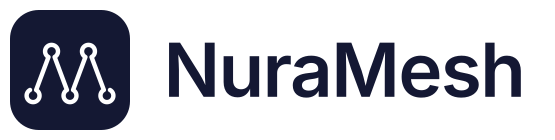
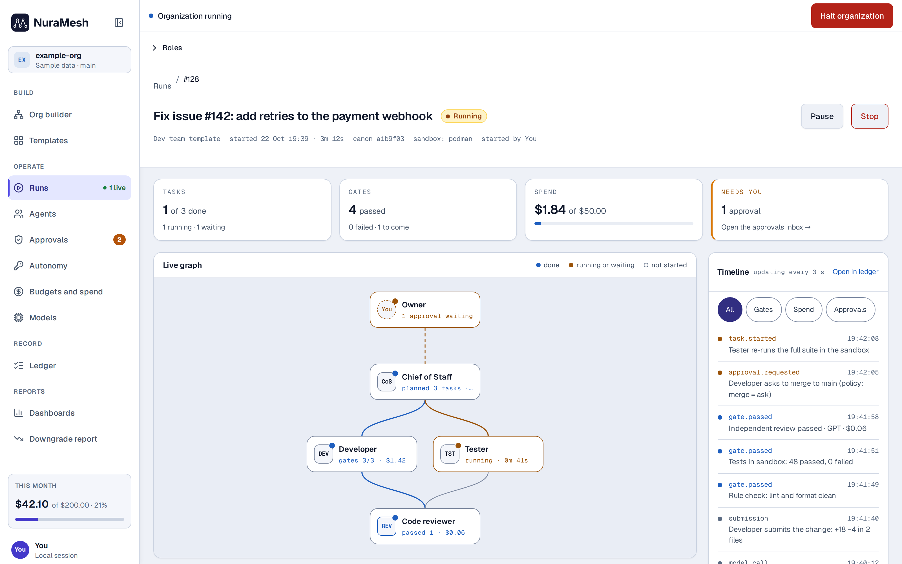
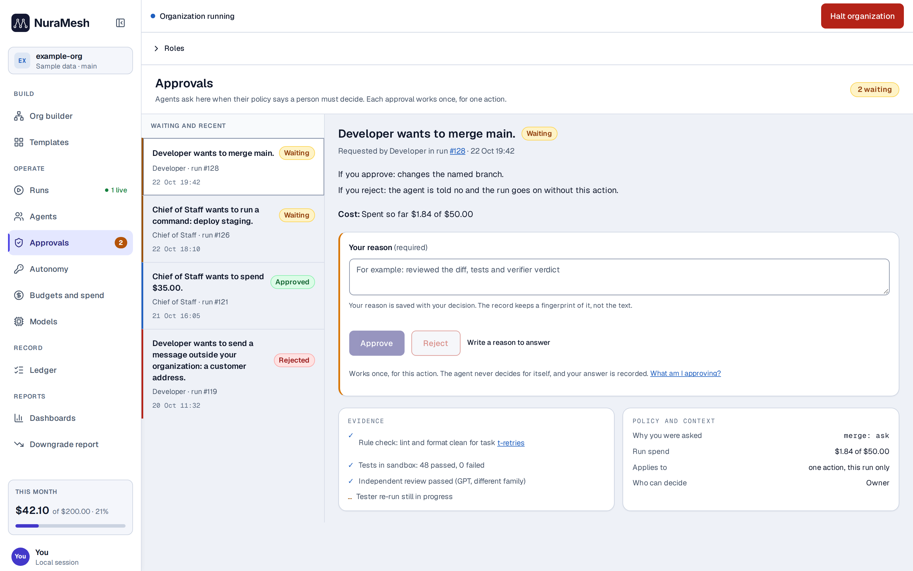
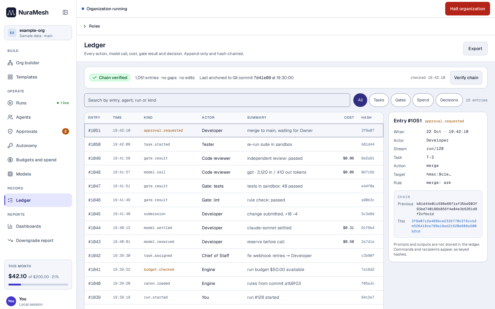

<p align="center">
  <picture>
    <source media="(prefers-color-scheme: dark)" srcset=".github/images/logo-dark.svg">
    
  </picture>
</p>

<h3 align="center">The AI control plane for agents you can trust.</h3>

<p align="center">Every action verified, approved where it matters, and always on the record.</p>

<p align="center">
  <a href="LICENSE"></a>
  <a href="https://github.com/nuramesh/nuramesh/actions"></a>
  
  <a href="https://x.com/NuraMeshAI"></a>
  <a href="https://www.linkedin.com/company/nuramesh"></a>
</p>

<p align="center">
  <a href="https://nuramesh.com">Website</a> &nbsp;·&nbsp;
  <a href="docs/quickstart.md">Quickstart</a> &nbsp;·&nbsp;
  <a href="https://github.com/nuramesh/nuramesh/discussions">Discussions</a> &nbsp;·&nbsp;
  <a href="https://nuramesh.com">Request access</a>
</p>

<br>

NuraMesh is an open-core control plane for teams of AI agents. You describe your agents as a team. NuraMesh checks every action against policy, stops spending at hard budget limits, accepts work only when it is verified, and records everything in a tamper-evident ledger that anyone can check offline.

**Two ways to use it**

- **No framework needed.** Build a team in the visual builder or in one YAML file, start from a template, and NuraMesh runs it with its own engine.
- **Already have agents?** NuraMesh sits on top of the framework you use, LangGraph today, and adds control and proof without a rewrite.

> [!TIP]
> Try it in two minutes on the built-in fake model. No API keys, no cost. See [Quickstart](#quickstart).

<br>

<p align="center">
  <picture>
    <source media="(prefers-color-scheme: dark)" srcset=".github/images/architecture-dark.svg">
    
  </picture>
</p>

## Why NuraMesh

<table>
<tr>
<td width="33%" valign="top">

**Verified work**<br>
A task is done only when its gates pass with cited evidence, not when an agent says so. Independent verifiers never see the worker's reasoning.

</td>
<td width="33%" valign="top">

**Default-deny control**<br>
Every action is allowed, asked or denied by policy. Approvals record who decided and why. A kill switch stops everything at once.

</td>
<td width="33%" valign="top">

**Hard budgets**<br>
Spend is checked before every model call, per run, team, agent or task. Unknown prices are blocked. A limit is a stop, not a warning.

</td>
</tr>
<tr>
<td valign="top">

**Tamper-evident ledger**<br>
Every action, model call, cost, gate result and approval is hash-chained and anchored in Git. `nuramesh ledger verify` proves it offline.

</td>
<td valign="top">

**Earned autonomy**<br>
Agents earn more freedom from evidence and per-role evals, always within ceilings you set.

</td>
<td valign="top">

**Your stack, your cloud**<br>
Self-hosted, no telemetry, no licence check over the network. Works with Azure OpenAI, Anthropic, OpenAI-compatible and local models.

</td>
</tr>
</table>

## See it in action

NuraMesh ships with a full web app. Build teams visually, watch runs live, approve actions and check the ledger, with no code.

<p align="center">
  
  
</p>
<p align="center">
  
  
</p>

## Quickstart

```bash
git clone https://github.com/nuramesh/nuramesh && cd nuramesh
uv sync --locked --extra local
uv run nuramesh init my-team     # a ready-made team with gates, policies and budgets
uv run nuramesh try my-team --fake --approve-as human:you --allow-unsandboxed --run-id first-run
```

The run executes the sample project's tests on your machine; `--allow-unsandboxed` says you accept that, so use a throwaway folder. Your whole team is one readable file (the nuramesh.yaml in your team folder), for example:

```yaml
policies:
  policies:
    - role: developer
      rules:
        - {action: call_model, decision: allow, target: "fake/*"}   # allowed
    - role: devops
      rules:
        - {action: merge, decision: ask, target: "*"}               # a human approves
budgets:
  - {id: dana-monthly, scope: agent, scope_id: dana, limit: {amount: "5.00", currency: USD}}
```

Anything no rule allows is denied. Check the ledger of your run:

```bash
uv run nuramesh ledger verify --team my-team   # proves nothing was changed after the fact
uv run nuramesh serve my-team                  # start the API server for the team
```

Next, run it and approve your first action: [docs/quickstart.md](docs/quickstart.md).

## Works with

Use NuraMesh on its own, or on top of the framework you already have.

| Agent frameworks | Status |
|---|---|
| NuraMesh built-in engine | Available |
| LangGraph | Available |
| OpenAI Agents SDK | Coming in December |
| Claude Agent SDK | Coming in December |

| Models | Status |
|---|---|
| Azure OpenAI, Anthropic | Available |
| OpenAI, Gemini, Mistral, Groq (OpenAI-compatible) | Available |
| Ollama, vLLM, LM Studio (local) | Available |
| AWS Bedrock, Google Vertex AI | Roadmap |

## Run it your way

| | Laptop | Team server | Enterprise |
|---|---|---|---|
| For | Trying it, solo builders | A small team on one machine | Organisations at scale |
| How | Library and CLI, SQLite | API server, PostgreSQL, web app | NuraMesh Enterprise, a separate product in development |
| Includes | Everything in the open core | Sign-in, MFA, invites | Planned: SSO (OIDC, SAML), SCIM, signed receipts, evidence packs |
| Start | [Quickstart](docs/quickstart.md) | [Self-hosting](docs/self-hosting.md) | [Request access](https://nuramesh.com), not in this repository |

## Resources

- [Documentation][docs-home]: guides, concepts and how-tos
- [How NuraMesh works](docs/anchors.md): the ledger and its anchors, the [kill switch](docs/kill-switch.md) and [model governance](docs/model-governance.md)
- [CLI](docs/cli.md) and [API](docs/api.md) reference: every command and endpoint
- [Examples and templates](examples/): ready-made agent teams you can run in minutes
- [Security model](SECURITY.md): what NuraMesh protects against, and how to report an issue
- [Discussions](https://github.com/nuramesh/nuramesh/discussions): questions, ideas and feedback
- [Contributing guide](CONTRIBUTING.md): how to contribute and find good first issues
- [Code of Conduct](CODE_OF_CONDUCT.md): community guidelines and standards
- Follow [@NuraMeshAI on X](https://x.com/NuraMeshAI) and [NuraMesh on LinkedIn](https://www.linkedin.com/company/nuramesh)

Security issues: please do not open a public issue. Email security@nuramesh.com or see [SECURITY.md](SECURITY.md).

---

<p align="center"><sub>Apache License 2.0. Built by AI Collective Labs Inc. "NuraMesh" is a trademark; see <a href="TRADEMARKS.md">TRADEMARKS.md</a>.</sub></p>

<!-- The one docs constant. The docs site is not live at launch, so the Documentation link
     points at the docs shipped in this repository. When the site is live, change the target
     on the single line below to the docs site URL. -->

[docs-home]: docs/quickstart.md
