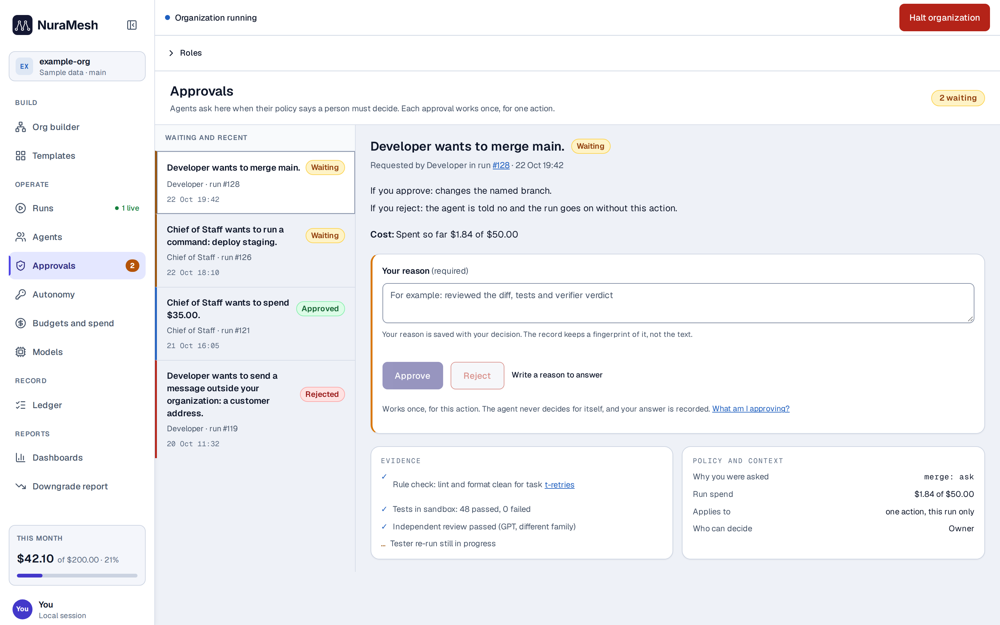

<a href="../../README.md">NuraMesh</a> / See it in action · 3 of 4

<h3 align="center">Approvals</h3>

Decide with a reason, on the record.

<a href="builder.md"><b>← Back</b></a>&nbsp;&nbsp;&nbsp;&nbsp;<a href="../../README.md#see-it-in-action">○</a>&nbsp;&nbsp;<a href="builder.md">○</a>&nbsp;&nbsp;<b>●</b>&nbsp;&nbsp;<a href="ledger.md">○</a>&nbsp;&nbsp;&nbsp;&nbsp;<a href="ledger.md"><b>Next →</b></a>

