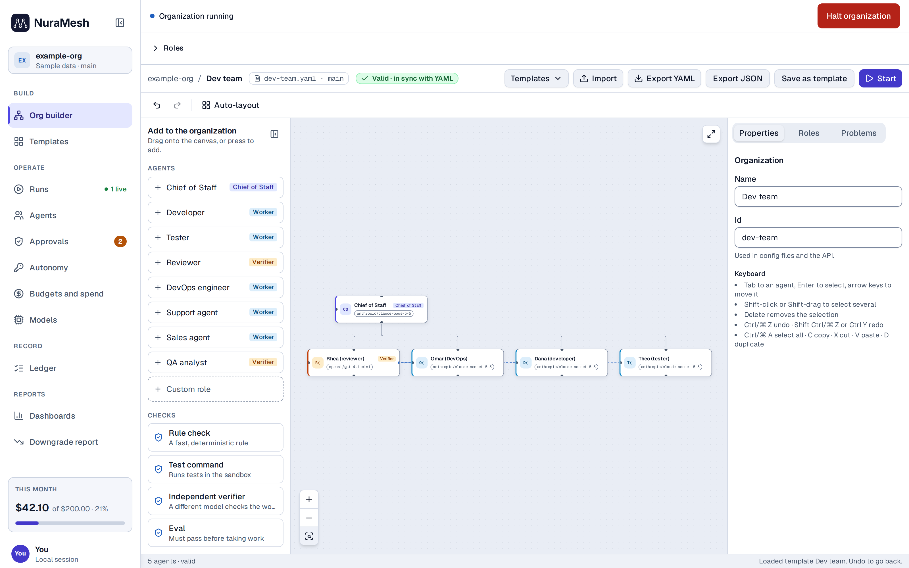

<a href="../../README.md">NuraMesh</a> / See it in action · 2 of 4

<h3 align="center">Builder</h3>

Drag agents and reporting lines.

<a href="../../README.md#see-it-in-action"><b>← Back</b></a>&nbsp;&nbsp;&nbsp;&nbsp;<a href="../../README.md#see-it-in-action">○</a>&nbsp;&nbsp;<b>●</b>&nbsp;&nbsp;<a href="approvals.md">○</a>&nbsp;&nbsp;<a href="ledger.md">○</a>&nbsp;&nbsp;&nbsp;&nbsp;<a href="approvals.md"><b>Next →</b></a>

