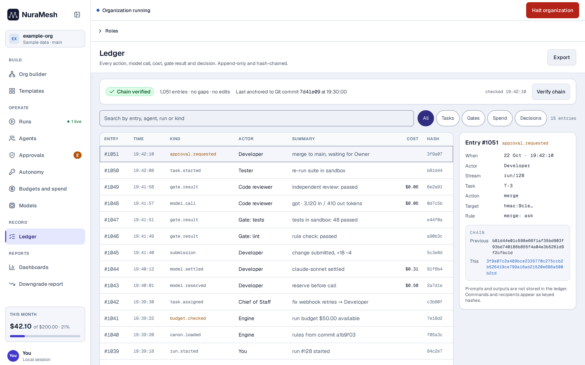

<a href="../../README.md">NuraMesh</a> / See it in action · 4 of 4

<h3 align="center">Ledger</h3>

Every entry chained and verified.

<a href="approvals.md"><b>← Back</b></a>&nbsp;&nbsp;&nbsp;&nbsp;<a href="../../README.md#see-it-in-action">○</a>&nbsp;&nbsp;<a href="builder.md">○</a>&nbsp;&nbsp;<a href="approvals.md">○</a>&nbsp;&nbsp;<b>●</b>&nbsp;&nbsp;&nbsp;&nbsp;Next →

<a href="../../README.md">Back to NuraMesh</a>

